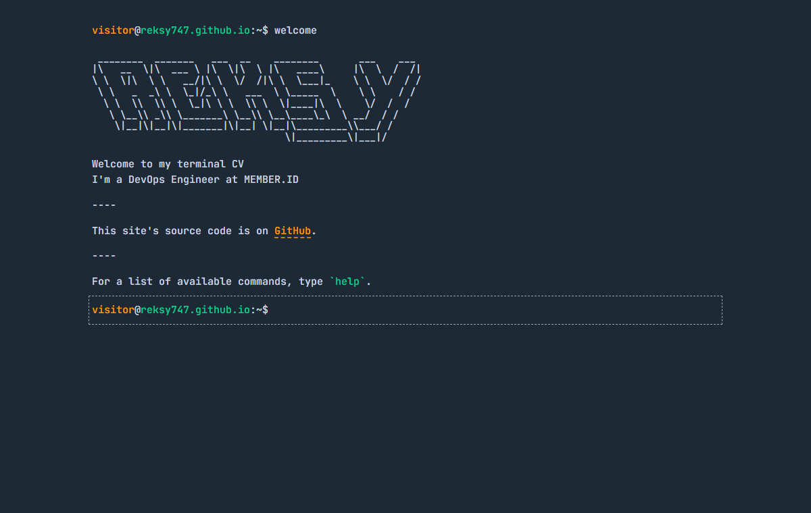

# Terminal Portfolio Website by Reksy




My CV and portfolio as a terminal you can type into, built with plain HTML, SCSS and JavaScript modules. It has six themes, keyboard shortcuts, and works offline. The full CV and portfolio are one command away.

## Demo

[reksy747.github.io](https://reksy747.github.io/): type `help` to start.

## About this project

It's my first time trying vibe coding, and honestly, I'm having a lot of fun with it.

I'm a DevOps engineer, and in 2026 I started vibe coding: turning ideas into code with AI, trying things out, breaking stuff and fixing the bugs I cause along the way.

Most of my time has gone into infrastructure: managing servers, running deployments and keeping systems up. Now I want to try the other side of development and build the ideas in my head with code and AI.

I'm still learning and still experimenting, and I'll probably break a lot more before I'm done. That's fine by me.

AI tools are changing fast. I think learning to build with them is one way to stay relevant in tech.

I'm not trying to become an expert overnight. I'm curious, and I'm learning one prompt at a time. 🚀

## Features

- Responsive design, from small phones to wide screens 📱💻
- Six themes 🎨
- Autocomplete ✨ (Tab | Ctrl + i)
- Go to previous and next command ⬆️⬇️
- View command history 📖
- Clear the screen 🧹 (Ctrl + l)
- `cv` and `projects` open the full CV and portfolio pages 📄
- PWA and offline support 🔥
- Tested with Node's built-in test runner ✅

## Commands

| Command | What it does |
| --- | --- |
| `about` | about Reksy |
| `cv` (or `resume`) | open my full CV page |
| `projects` (or `portfolio`) | open my portfolio page |
| `education` | my education background |
| `socials` | check out my social accounts |
| `email` | send an email to me |
| `gui` | go to my CV in GUI |
| `echo` | print out anything |
| `pwd` | print current working directory |
| `whoami` | about current user |
| `themes` | check available themes; `themes set <name>` to switch |
| `history` | view command history |
| `welcome` | display hero section |
| `help` | check available commands |
| `clear` | clear the terminal |

## Tech Stack

**Frontend** - HTML, JavaScript (ES modules, no framework)  
**Styling** - [Sass](https://sass-lang.com/), built with [gulp](https://gulpjs.com/)  
**Fonts** - [JetBrains Mono](https://www.jetbrains.com/lp/mono/) via [Fontsource](https://fontsource.org/), self-hosted  
**Offline** - Service worker and web app manifest  
**Testing** - [Node.js test runner](https://nodejs.org/api/test.html)  
**Deployment** - [GitHub Pages](https://pages.github.com/)

## Multiple Themes

The terminal has 6 themes: `dark` (default), `light`, `dracula`, `nord`, `ubuntu` and `matrix`. Type `themes` in the terminal to list them, and `themes set <name>` to switch. Your choice is remembered next time you visit.

## Running Locally

You need Node.js 22 or newer.

Clone the project

```bash
git clone https://github.com/Reksy747/Reksy747.github.io.git
```

Go to the project directory

```bash
cd Reksy747.github.io
```

Install dependencies

```bash
npm install
```

Build the CSS and JavaScript

```bash
npm run build
```

Run the tests

```bash
npm test
```

Start a local server (any static file server works; opening `index.html` straight from disk won't, because browsers block JavaScript modules on `file://`)

```bash
python -m http.server 5173
```

Then open http://localhost:5173.

## Deploying

GitHub Pages serves the `master` branch as it is, so commit the compiled files in `css/` and `js/` along with the sources. When you change anything the service worker caches, bump `VERSION` in `sw.js` so returning visitors drop their old offline copy.

## Inspiration and Credits

The idea and the commands are inspired by Sat Naing's [terminal portfolio](https://github.com/satnaing/terminal-portfolio). This site is my own version, built from scratch with plain HTML, SCSS and JavaScript instead of React.

## Author

- [@Reksy747](https://github.com/Reksy747)
